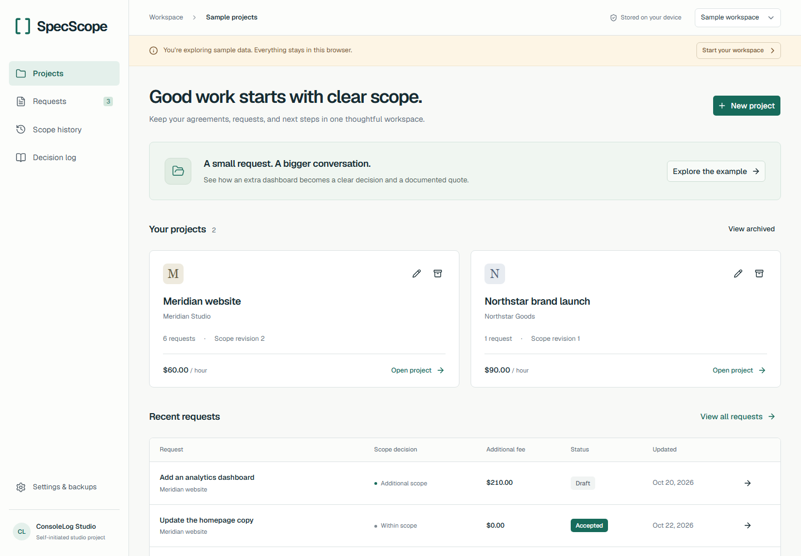
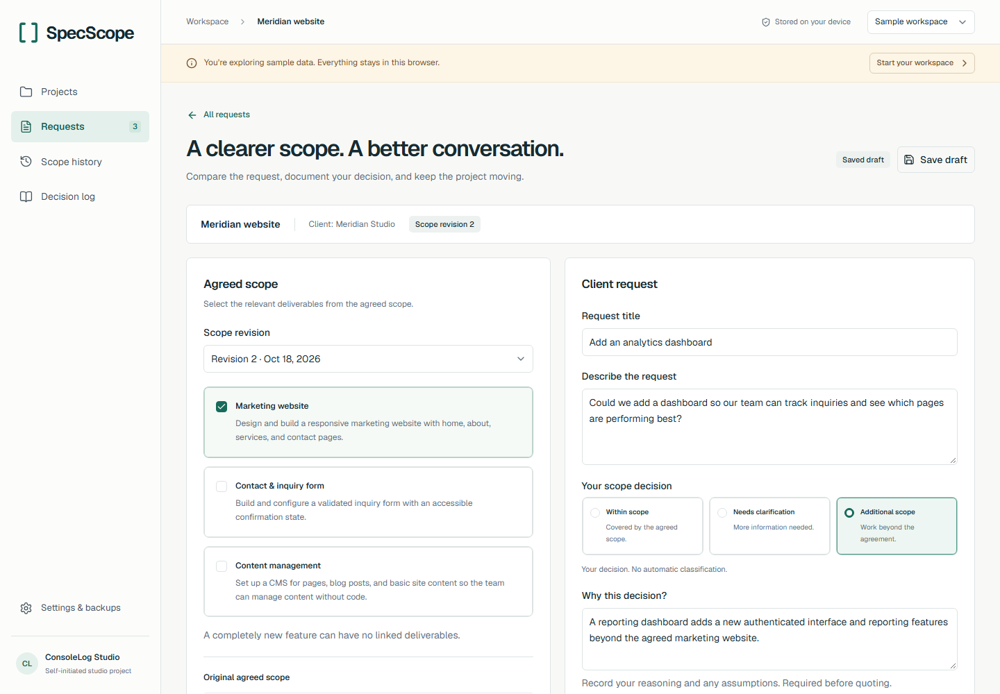
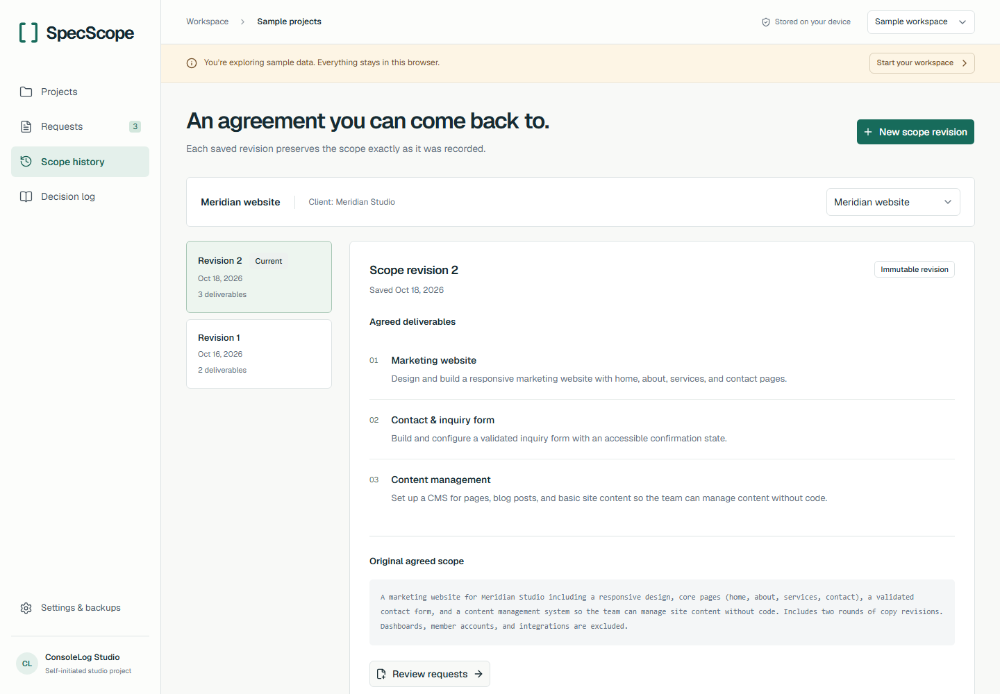
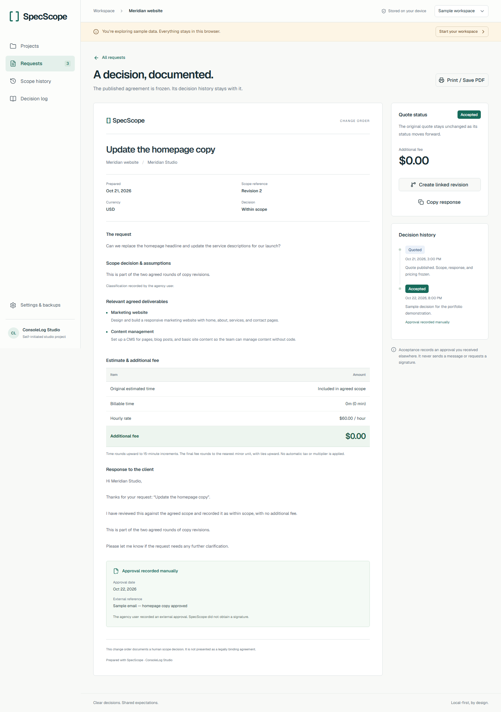
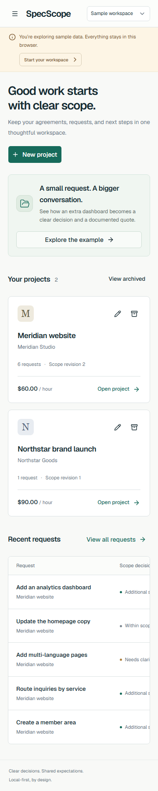

# SpecScope

**Self-initiated studio project · ConsoleLog Studio · Portfolio concept**

## A small request can change a whole project

An agency agrees to build a marketing website. Later, a client asks for an analytics dashboard. The request sounds small in a message, but it adds a different interface and reporting workflow.

SpecScope gives that conversation a clear home: put the request beside the agreed deliverables, make a human scope decision, explain it, and prepare a transparent quote.

The examples below are fictional. This is not commissioned client work, and no customer outcomes or time savings are claimed.

## The complete workflow

    Project → Agreed scope revision → Client request → Human scope decision
        → Rounded estimate → Editable response → Frozen quote
        → Manually recorded acceptance / rejection / deferral

1. **Keep the agreement visible.** The scope history preserves earlier revisions so an old request never silently moves to a newer agreement.
2. **Make the reasoning explicit.** Within scope, Needs clarification, and Additional scope are user choices, accompanied by the agency’s own explanation.
3. **Show the arithmetic.** At 60.00/hour, an estimate of 20 minutes becomes 30 billable minutes and a 30.00 additional fee.
4. **Preserve the evidence.** Publishing freezes the exact request, scope references, identifying details, rate, fee, and response. Later edits create a linked draft.
5. **Close the loop honestly.** Acceptance means the agency recorded an external approval reference and date. The software did not send a message or obtain a signature.

## The product in use

### Projects: the starting point

Projects keep the agreed scope and incoming requests together. A separate editable sample workspace lets a portfolio visitor explore the complete product without entering personal records.

### Comparison: context before a decision

The agreement stays beside the request. Deliverable links add context, while a completely new feature can remain unlinked. The user records the decision; there is no automatic contract interpretation.

### Scope history: revisions stay intact

Each revision is preserved independently. Updating agreed deliverables cannot rewrite the scope attached to an earlier published quote.

### Quote: an explicit next step

The document shows the original request, decision reasoning, relevant deliverables, calculation policy, and saved response. Print styles support A4 and US Letter.

### Phone layout

On narrow screens, the comparison panels stack and navigation moves into an accessible menu. Tables retain a deliberate horizontal scroll region.

## Why these engineering choices matter

- **Local records:** project content stays in IndexedDB. There is no account requirement, content upload, analytics, or paid inference API.
- **Exact money:** rates and fees use integer minor units, with explicit rounding rather than floating-point approximations.
- **Atomic saves:** a workspace revision check and the write share an IndexedDB transaction. A stale tab cannot silently overwrite a newer save.
- **Portable recovery:** validated JSON backups include scope snapshots and decision history. Imports replace the selected workspace only after confirmation.
- **Static deployment:** Next.js exports fixed route documents for Cloudflare Pages. The app does not need a server runtime.

## Evidence and limits

See [verification results](verification.md) for the actual commands, acceptance checks, browser engines, performance measurements, and untested environments.

The implementation passes 70 domain/persistence tests and 93 browser checks across Chromium, Firefox, WebKit, Chrome, and Edge. Two native clipboard read-back checks are skipped where automation permissions are unavailable. On the documented reference laptop, 20 live estimate updates with the maximum supported record counts settle within 10.6 ms each, against the 200 ms target. These are engineering measurements of synthetic fixtures, not customer outcomes.

The product does not synchronize across devices or browsers. Browser storage can be removed, so backups matter. Approvals are manually recorded, and documents are not presented as legally binding.

The zero-cost design uses free, commercially usable dependencies and static hosting. It does not imply developer labor or every future extension is free.

## Walkthrough and contact

[Watch the complete sample workflow](evidence/specscope-walkthrough.webm)

Live application: [specscope.pages.dev](https://specscope.pages.dev/).

Source: [shawalkabirchy/specscope on GitHub](https://github.com/shawalkabirchy/specscope). Pushing to `main` triggers a Cloudflare Pages production build.

[Discuss a similar workflow with ConsoleLog Studio](https://consolelog.studio/)
